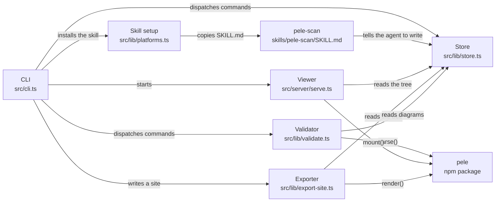

# oh-my-pele

[English](README.md) · [繁體中文](README.zh-TW.md)

Local, offline architecture diagrams for coding agents. An agent scans a repository and writes a tree of Mermaid diagrams. oh-my-pele renders that tree on your machine with [pele](https://github.com/obsidianmd/pele).

**This is not an official Obsidian project.**

Powered by pele (MIT, kepano).
Inspired by [oh-my-mermaid](https://github.com/oh-my-mermaid/oh-my-mermaid) (MIT).

Diagrams are not uploaded. `view` serves a loopback page and reads pele from the installed npm package. `export` writes one HTML file with pele inlined, plus an SVG for each diagram, so you can open the result from disk or put it on GitHub Pages yourself.

## Install

Node.js 22 or newer.

```bash
npm install -g oh-my-pele
```

From a checkout of this repository:

```bash
npm install
npm run build
node dist/cli.js --help
```

The package is set up to publish (`name`, `bin`, `files`, `prepublishOnly`). It is not published from this repository's build.

`oh-my-pele` and `omp` are the same command.

## Usage

Install the `/pele-scan` skill for Claude Code, Codex, and Cursor:

```bash
oh-my-pele setup
```

That copies `skills/pele-scan/SKILL.md` into this project:

| Tool | Project skill | Home skill (`--global-only`) |
| --- | --- | --- |
| Claude Code | `.claude/skills/pele-scan/` | `~/.claude/skills/pele-scan/` |
| Codex | `.agents/skills/pele-scan/` | `~/.codex/skills/pele-scan/` |
| Cursor | `.cursor/skills/pele-scan/` | `~/.cursor/skills/pele-scan/` |

`oh-my-pele setup --list` prints those paths. `oh-my-pele setup --remove` deletes the copies. `oh-my-pele setup cursor` limits the install to one tool.

In the agent:

```text
/pele-scan
```

The skill writes three perspectives (`overall-architecture`, `data-flow`, `external-integrations`), drills into modules that have real internal structure, and fills constraint, concern, and todo. Then:

```bash
oh-my-pele validate
oh-my-pele view
oh-my-pele export --out pele-site
```

`validate` parses every `diagram.mmd` with pele and prints the line and column when a diagram is wrong. `view` defaults to [http://127.0.0.1:4173](http://127.0.0.1:4173). `export` refuses to write if any diagram fails to parse.

### Commands

| Command | What it does |
| --- | --- |
| `setup [claude\|codex\|cursor]` | Install or remove `/pele-scan` |
| `view [--port N] [--host H] [--open]` | Local viewer. File saves reload the page |
| `validate [path] [--json]` | Parse diagrams with pele |
| `export [--out dir] [--theme light\|dark\|auto]` | `index.html` plus `svg/*.svg` |
| `init` | Create an empty `.omm/` |
| `tree [path]` | Print the element tree |
| `config [key]` | Print `config.yaml`. `config language` defaults to `en` |
| `read <path> <field>` | Print one field |
| `write <path> <field> -` | Write one field from stdin and update `meta.yaml` |

Every command accepts `--dir` for the project root. Paths use slashes: `overall-architecture/viewer`.

Fields: `description`, `diagram`, `context`, `constraint`, `concern`, `todo`, `note`.

## `.omm` format

The directory layout matches oh-my-mermaid, so an existing `.omm/` folder can be opened here without a conversion step.

```text
.omm/
├── config.yaml
├── overall-architecture/
│   ├── description.md
│   ├── diagram.mmd
│   ├── context.md
│   ├── constraint.md
│   ├── concern.md
│   ├── todo.md
│   ├── note.md
│   ├── meta.yaml
│   └── viewer/
│       ├── diagram.mmd
│       └── http-server/
│           └── description.md
├── data-flow/
└── external-integrations/
```

A subdirectory is a child diagram. Its folder name is the Mermaid node id. The viewer orders children by where those ids appear in `diagram.mmd`, and it highlights flowchart nodes you can open. The side panel shows whichever of the seven fields exist. `meta.yaml` keeps the keys oh-my-mermaid writes (`created`, `updated`, `update_count`, `last_field`, `kind`, `title`, `children`, `parentPath`, and `prev_diagram` when a diagram is replaced). Extra keys, including a `cloud:` block, are left in place. This tool never pushes them anywhere.

`fixtures/from-omm/` is a shortened copy of oh-my-mermaid's own `.omm` example, used by the tests. One of those diagrams (`command-surface`) uses the node id `class-field`. Pele's lexer treats a leading `class` as the class keyword, so `validate` reports line 22 with the offending id and a suggested rename (`class_field`). The other diagrams in that excerpt parse.

## Demo

`.omm/` at the root of this repository is a scan of oh-my-pele. Six diagrams, no validate warnings:

```text
overall-architecture  diagram
  cli  diagram
    setup-command
    view-command
    validate-command
    export-command
    read-write
  store
  validator
  viewer  diagram
    http-server
    viewer-page
    file-watch
  exporter
  skill-setup
  pele-scan
data-flow  diagram
  codebase
  agent
  skill
  omm-dir  diagram
  pele
  viewer
  export-bundle
external-integrations  diagram
  oh-my-pele
  pele
  claude-code
  codex
  cursor
  github-pages
```

The top diagram:



```bash
oh-my-pele view
```

The page has a tree, the diagram, chips for child diagrams, and a side panel. Light and dark themes set `--pele-*` variables. Escape moves up one level. Drag pans, and Ctrl-scroll zooms, using pele's own controls.

`scripts/seed-demo.mjs` rewrites this demo after `npm run build`. It calls `writeField`, so the `meta.yaml` files are the ones the CLI produces.

## Themes

The viewer and the exported HTML follow the page theme. Standalone SVGs take a `--theme` flag on `export`: `light` (default), `dark`, or `auto`. `auto` embeds a `prefers-color-scheme` stylesheet, so one SVG file works on light and dark pages. Colors come from CSS variables, not from a hosted theme.

## Development

```bash
npm test
npm run typecheck
npm run build
node dist/cli.js validate
```

## License

MIT, copyright tboydar. See [LICENSE](LICENSE) and [NOTICE](NOTICE).

Pele is MIT, copyright kepano. The `.omm` format and the files under `fixtures/from-omm/` are MIT, copyright oh-my-mermaid. Pele's zoom-reset icon comes from Lucide (ISC) and stays inside the pele package. oh-my-pele does not copy that source.
