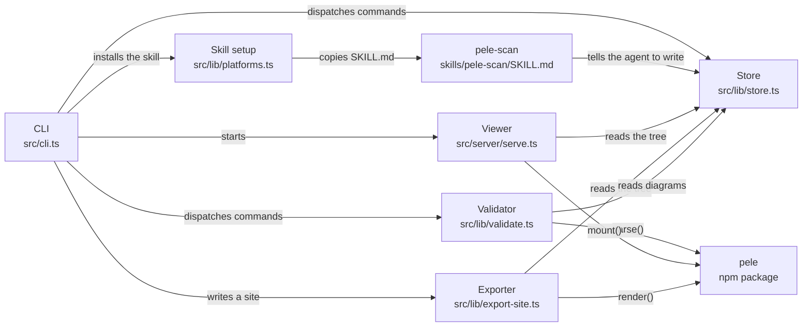

# oh-my-pele

[English](README.md) · [繁體中文](README.zh-TW.md)

給程式代理用的本機、離線架構圖。代理掃描儲存庫，寫下一棵 Mermaid 圖。oh-my-pele 用 [pele](https://github.com/obsidianmd/pele) 在你自己的機器上把這棵樹畫出來。

**這不是 Obsidian 官方專案。**

由 pele 驅動（MIT，kepano）。
靈感來自 [oh-my-mermaid](https://github.com/oh-my-mermaid/oh-my-mermaid)（MIT）。

圖不會被上傳。`view` 只在本機迴路位址提供頁面，並從已安裝的 npm 套件讀取 pele。`export` 寫出一份內嵌 pele 的 HTML，以及每張圖一份 SVG。你可以用檔案總管直接打開，或自行放到 GitHub Pages。

## 安裝

需要 Node.js 22 或更新的版本。

```bash
npm install -g oh-my-pele
```

若是從這份儲存庫建置：

```bash
npm install
npm run build
node dist/cli.js --help
```

`package.json` 已具備發布所需的 `name`、`bin`、`files` 與 `prepublishOnly`。這個儲存庫的建置流程不會把套件發布到 npm。

`oh-my-pele` 與 `omp` 是同一個指令。

## 用法

為 Claude Code、Codex 與 Cursor 安裝 `/pele-scan` 技能：

```bash
oh-my-pele setup
```

它會把 `skills/pele-scan/SKILL.md` 複製到這個專案：

| 工具 | 專案內技能 | 家目錄技能（`--global-only`） |
| --- | --- | --- |
| Claude Code | `.claude/skills/pele-scan/` | `~/.claude/skills/pele-scan/` |
| Codex | `.agents/skills/pele-scan/` | `~/.codex/skills/pele-scan/` |
| Cursor | `.cursor/skills/pele-scan/` | `~/.cursor/skills/pele-scan/` |

`oh-my-pele setup --list` 會印出這些路徑。`oh-my-pele setup --remove` 會刪除複製出去的技能。`oh-my-pele setup cursor` 只安裝給其中一個工具。

在代理裡執行：

```text
/pele-scan
```

這個技能會寫出三個視角（`overall-architecture`、`data-flow`、`external-integrations`），在內部結構確實存在的模組上繼續往下展開，並填上 constraint、concern 與 todo。接著：

```bash
oh-my-pele validate
oh-my-pele view
oh-my-pele export --out pele-site
```

`validate` 用 pele 解析每一份 `diagram.mmd`。圖有問題時，會印出行號與欄號。`view` 預設開在 [http://127.0.0.1:4173](http://127.0.0.1:4173)。只要有任何一張圖解析失敗，`export` 就不會寫出檔案。

### 指令

| 指令 | 作用 |
| --- | --- |
| `setup [claude\|codex\|cursor]` | 安裝或移除 `/pele-scan` |
| `view [--port N] [--host H] [--open]` | 本機檢視器。存檔後頁面會重新載入 |
| `validate [path] [--json]` | 用 pele 解析圖 |
| `export [--out dir]` | 產出 `index.html` 與 `svg/*.svg` |
| `init` | 建立空的 `.omm/` |
| `tree [path]` | 印出元素樹 |
| `config [key]` | 印出 `config.yaml`。`config language` 預設是 `en` |
| `read <path> <field>` | 印出一個欄位 |
| `write <path> <field> -` | 從標準輸入寫入一個欄位，並更新 `meta.yaml` |

每個指令都可以用 `--dir` 指定專案根目錄。路徑使用斜線，例如 `overall-architecture/viewer`。

欄位名稱：`description`、`diagram`、`context`、`constraint`、`concern`、`todo`、`note`。

## `.omm` 格式

目錄配置與 oh-my-mermaid 相同，既有的 `.omm/` 資料夾可以直接打開，不需要轉換。

```text
.omm/
├── config.yaml
├── overall-architecture/
│   ├── description.md
│   ├── diagram.mmd
│   ├── context.md
│   ├── constraint.md
│   ├── concern.md
│   ├── todo.md
│   ├── note.md
│   ├── meta.yaml
│   └── viewer/
│       ├── diagram.mmd
│       └── http-server/
│           └── description.md
├── data-flow/
└── external-integrations/
```

子目錄就是子圖，資料夾名稱就是 Mermaid 節點 id。檢視器依照這些 id 在 `diagram.mmd` 裡出現的位置排列子項目，並把可以點開的流程圖節點標出來。側欄顯示七個欄位裡實際有寫的內容。`meta.yaml` 保留 oh-my-mermaid 會寫的鍵（`created`、`updated`、`update_count`、`last_field`、`kind`、`title`、`children`、`parentPath`，以及圖被改寫時的 `prev_diagram`）。其他鍵，包括 `cloud:` 區塊，會原樣留下。這個工具不會把它們推送到任何地方。

`fixtures/from-omm/` 是 oh-my-mermaid 自己的 `.omm` 範例的節錄，測試會用到它。其中 `command-surface` 這張圖的節點 id 是 `class-field`。pele 的詞法分析器會把開頭的 `class` 看成 class 關鍵字，因此 `validate` 會回報第 22 行。這份節錄裡的其他圖可以正常解析。

## 示範

這個儲存庫根目錄的 `.omm/` 就是對 oh-my-pele 自己做的一次掃描。六張圖，`validate` 沒有警告：

```text
overall-architecture  diagram
  cli  diagram
    setup-command
    view-command
    validate-command
    export-command
    read-write
  store
  validator
  viewer  diagram
    http-server
    viewer-page
    file-watch
  exporter
  skill-setup
  pele-scan
data-flow  diagram
  codebase
  agent
  skill
  omm-dir  diagram
  pele
  viewer
  export-bundle
external-integrations  diagram
  oh-my-pele
  pele
  claude-code
  codex
  cursor
  github-pages
```

最上面那張圖：



```bash
oh-my-pele view
```

頁面上有樹狀目錄、圖、子圖的快捷按鈕，以及側欄。淺色與深色主題都是設定 `--pele-*` 變數。按 Escape 會回到上一層。拖曳可以平移，按住 Ctrl 捲動可以縮放，用的是 pele 自己的控制項。

`scripts/seed-demo.mjs` 會在 `npm run build` 之後重寫這份示範。它呼叫 `writeField`，所以產生的 `meta.yaml` 與指令列寫入的格式相同。

## 主題

檢視器與匯出的 HTML 會跟著頁面主題走。單獨的 SVG 以淺色盤繪製（`--pele-accent: #c2410c`，以及其餘的淺色變數）。顏色來自 CSS 變數，不來自遠端主題服務。

## 開發

```bash
npm test
npm run typecheck
npm run build
node dist/cli.js validate
```

## 授權

MIT，著作權人 tboydar。見 [LICENSE](LICENSE) 與 [NOTICE](NOTICE)。

pele 為 MIT，著作權人 kepano。`.omm` 格式以及 `fixtures/from-omm/` 底下的檔案為 MIT，著作權人 oh-my-mermaid。pele 的縮放重設圖示來自 Lucide（ISC），並留在 pele 套件裡。oh-my-pele 沒有複製那段原始碼。
