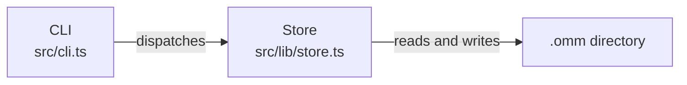

# pele-scan — local architecture scan

You write architecture documentation into `.omm/` at the project root. A local viewer renders the Mermaid with pele. Nothing is uploaded.

This is not an official Obsidian project. pele is the renderer (MIT, kepano). The directory layout is compatible with oh-my-mermaid (MIT) so an existing `.omm/` folder can be read and updated in place.

## What to produce

Always create these three perspectives, even when one of them is small:

| Directory | Question it answers |
| --- | --- |
| `overall-architecture` | What the main pieces are and how they connect |
| `data-flow` | Where information comes from, how it changes, and where it lands |
| `external-integrations` | What the system talks to outside its own source tree |

If a perspective is thin, say so in the prose. Do not invent services that are not in the code. For `external-integrations`, local-only tools, package dependencies that run in-process, git, the filesystem, and "no network services" are valid findings.

## Directory format

`.omm/` is the whole database. One folder per element. Subfolders are child diagrams. Node ids in a diagram are the child folder names.

```text
.omm/
├── config.yaml
├── overall-architecture/
│   ├── description.md
│   ├── diagram.mmd
│   ├── context.md
│   ├── constraint.md
│   ├── concern.md
│   ├── todo.md
│   ├── note.md
│   └── some-module/
│       ├── description.md
│       ├── diagram.mmd
│       └── a-leaf/
│           └── description.md
├── data-flow/
└── external-integrations/
```

Field files, exact names:

| Field | File | What belongs there |
| --- | --- | --- |
| description | `description.md` | What this element is and which files it covers |
| diagram | `diagram.mmd` | Mermaid source. Omit on a leaf that has no inner structure |
| context | `context.md` | Why it exists, the runtime or library it sits in |
| constraint | `constraint.md` | Rules the code actually has to live with |
| concern | `concern.md` | Real risks, bottlenecks, or sharp edges |
| todo | `todo.md` | Follow-up work grounded in the code, not a generic wishlist |
| note | `note.md` | Short asides that do not fit the other fields |

`config.yaml` may contain `version`, `theme`, and `language`. Keep any other keys already in the file (including oh-my-mermaid cloud keys). Do not add a cloud upload step.

`meta.yaml` is optional for readers. Prefer `oh-my-pele write` so `meta.yaml` stays in the shape oh-my-mermaid writes (`created`, `updated`, `update_count`, `last_field`, `kind`, `title`, `children`, `parentPath`).

## How to write a field

If `oh-my-pele` is on `PATH`, or you can run `npx oh-my-pele`:

```bash
oh-my-pele config language

oh-my-pele write overall-architecture description - <<'EOF'
What this perspective shows.
EOF
```

`write` reads stdin when the content argument is `-`. One field per command. Use a slash path for nested elements: `overall-architecture/some-module`.

If the CLI is not available, create the same files yourself. Directory names and the seven filenames above are the format. Do not invent parallel filenames.

Check the language first. Write prose in `.omm/config.yaml`'s `language` (English when the key is missing). Element ids, directory names, and diagram node ids stay English kebab-case either way.

## Scan steps

1. Read the manifest (`package.json`, `pyproject.toml`, `Cargo.toml`, `go.mod`, or the equivalent) and the top-level tree. Open entry points, not every file.
2. Create or update the three perspectives.
3. For every node in a diagram, write `description.md`. That folder is the element.
4. Drill in when the code behind a node has real internal parts (several modules, a server plus a page, a pipeline of stages). Give that element its own `diagram.mmd` and repeat. Stop at a leaf when the code is one file, a thin wrapper, or an outside system.
5. On every perspective, fill description, diagram, context, constraint, concern, todo, and note. On every drilled-in element that has a diagram, fill constraint, concern, and todo as well. On a leaf, add those three only when the code gives you something specific to say.
6. Run `oh-my-pele validate` (or `npx oh-my-pele validate`). It parses every `diagram.mmd` with pele and prints `line` and `column`. Fix those lines. Re-run until there are no errors. Then tell the user to open `oh-my-pele view`.

Do not rewrite an element whose source has not changed. Do not create a cycle where a child diagram points back at its parent as a child folder.

## Diagram rules pele will accept

Use `graph LR` for flows and `graph TD` for hierarchies. Flowcharts are the diagrams the viewer can drill by clicking a node.



- The node id (`cli`, `omm-dir`) is the child directory name when that node has its own folder. Kebab-case. Do not put spaces in ids. Do not start an id with a Mermaid keyword such as `class`, `style`, `click`, `subgraph`, or `end` (`class-field` is read as the `class` statement, `end-node` as the block-closing `end`). Use `field-handler` instead. `validate` reports the offending id, line, and column when a diagram does this.
- The label is two lines when you know the path: display name, then `\n`, then the file or directory.
- Every edge has a label: `A -->|"what crosses this edge"| B`.
- Keep a diagram to about 5–12 nodes. If you need more, push the detail into a child diagram.
- A child folder with no matching node id is a warning (`child-not-in-diagram`). The tree can still open it; the drawing cannot.
- Optional classes, only these names:

```text
classDef external fill:#585b70,stroke:#585b70,color:#cdd6f4
classDef concern fill:#f38ba8,stroke:#f38ba8,color:#1e1e2e
classDef entry fill:#89b4fa,stroke:#89b4fa,color:#1e1e2e
classDef store fill:#a6e3a1,stroke:#a6e3a1,color:#1e1e2e
```

`external` is outside the repo, `concern` is a known risk, `entry` is a CLI or request entry, `store` is durable state.

Stay with quoted text, solid and dotted arrows, and `class` / `classDef`. Skip HTML labels, `%%{init}` directives, and click callbacks. The viewer discovers children from the folders, not from Mermaid click events.

## After the scan

Summarize the three perspectives, which nodes became child diagrams, and any pele errors you fixed. Point the user at `oh-my-pele view` and `oh-my-pele export`. Remind them the pictures stay on this machine.
